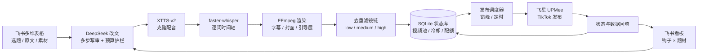

# TikTok 小说推文自动化

把「选题 → AI 改文 → 克隆配音 → 字幕 → 成片 → 去重 → 排期 → 发布 → 数据回填」串成一条可重复运行的流水线，让少量运营人员也能稳定管理大量海外 TikTok 账号。

> 这是作品集用的**净化版**仓库：只保留源码与工程配置。真实业务数据、账号凭证、素材、模型、成品视频和日志均已移除。

## 它解决什么问题

小说推文账号的内容生产有大量重复动作：同一部小说要拆成多条口播脚本，每条都要配音、配字幕、换背景、做出差异，再按账号配额和冷却规则排期发布，最后把播放/完播数据拉回来判断哪种钩子有效。

人工做这些事，规模一上来就会失控。这个系统把规则写进 SQLite 和调度器，把创作交给 LLM，把重复劳动交给流水线：

- **内容侧**：一部小说 → 多条不同钩子的英文口播脚本 → 配音 → 逐词字幕 → 1080×1920 成片
- **风控侧**：镜像、缩放裁切、调色、噪点、锐化、帧率、变速多档随机化，降低成品相似度
- **运营侧**：30 天同号同题材冷却、每号每日配额、全局发布上限、跨账号错峰、美东时区定时发布
- **反馈侧**：回填播放/完播/互动指标，按「钩子 × 题材」聚合，驱动下一轮选题与脚本策略

## 架构



配套的本地控制台（`127.0.0.1:8770`）用于改配置、测连通性、触发生成/发布和查看状态。

## 核心能力

| 模块 | 做法 |
| --- | --- |
| 改文 | DeepSeek 多步写审分离（生成 → 自检 → 修订），带调用预算护栏；失败自动回落到单步模式 |
| 配音 | XTTS-v2 声音克隆，独立 Python 3.11 子环境；音频做 -14 LUFS 响度归一化与 ±3% 语速抖动 |
| 字幕 | faster-whisper 转写，输出 ASS；显式写入 `PlayResX/Y`，逐词模式带弹入动画 |
| 渲染 | 单次转写 + 两段 FFmpeg pass 复用字幕；文字层在几何变换之后叠加，避免被镜像/裁切影响 |
| 去重 | 镜像、随机缩放裁切、亮度/对比度/饱和度/色相、噪点、锐化、帧率、变速，每条独立随机 |
| 状态库 | SQLite 把冷却、配额、序号、文案配对、背景去重变成查询；单实例锁避免并发写坏库 |
| 调度 | 计划与执行分离；`plan` 只读预览，`run` 才上传发布；用平台 `pub_time` 定时，跑一次即可 |
| 数据闭环 | 回填播放/完播/互动；杠杆引擎一次只试验一个变量，其余冻结在冠军值 |
| 控制台 | 本机 Web UI；凭证回显一律脱敏；校验 `Host`/`Origin`，降低 DNS rebinding / CSRF 风险 |

## 快速开始（离线演示）

无需任何 API Key、ffmpeg 或模型：

```bash
python -m venv .venv
# Windows
.venv\Scripts\activate
# macOS / Linux
source .venv/bin/activate

pip install -r requirements-dev.txt
python demo.py
```

演示会在 `_demo/` 下建一个临时状态库，写入 3 个账号、5 个关键词、15 条待发视频，然后输出当天的发布计划、去重参数和杠杆分配：

```text
今日发布计划：6 条（时间为美东 ET）
10-19 10:03 ET   demo_uk_01    Charlie_03  Charlie
10-19 10:14 ET   demo_us_02    Echo_01     Echo
...
  demo_uk_01: 2 条
  demo_us_01: 2 条
  demo_us_02: 2 条
```

## 3 分钟填 Key

仓库里只有 `*.example.*` 模板，没有任何真实凭证。第一次跑真实接口时，任选一种方式。

### 方式 A：本地 JSON（本机运行推荐）

```bash
cp deepseek.example.json deepseek.json
cp feishu.example.json feishu.json
cp feixing.example.json feixing.json
```

打开三个文件，把中文占位值换成自己的：

| 文件 | 必填字段 | 从哪里拿 |
| --- | --- | --- |
| `deepseek.json` | `api_key` | [DeepSeek 控制台](https://platform.deepseek.com/api_keys) → API Keys |
| `feishu.json` | `app_id` / `app_secret` / `app_token` | [飞书开放平台](https://open.feishu.cn/app) → 应用凭证；`app_token` 在多维表格 URL 中 |
| `feixing.json` | `api_key` / `team_id` | 飞星 UPMee 后台 |

只跑某一步就只填对应文件，不用的可以删掉。优先级仍然是：**环境变量 > 本地 JSON > 默认值**。

### 方式 B：环境变量（Docker / CI / 服务器推荐）

```bash
cp .env.example .env
```

Docker Compose 会自动读取 `.env`；本地直接运行 `python ...` 不会，需要先手动设置环境变量，例如 PowerShell：

```powershell
$env:DEEPSEEK_API_KEY="sk-..."
python rewrite.py test
```

也可以写进系统环境变量或 CI Secrets。

### 最小填写组合

| 你要做的事 | 最少需要 |
| --- | --- |
| 离线演示 `python demo.py` | 不需要任何 Key |
| AI 改文 | `DEEPSEEK_API_KEY` 或 `deepseek.json` |
| 同步飞书表格 | 飞书三项：`app_id` / `app_secret` / `app_token` |
| 发布到飞星 | 飞星两项：`api_key` / `team_id` |

填完先验证：

```bash
python demo.py          # 不需要 Key
python rewrite.py test  # 会真实调用一次 DeepSeek，可能产生少量费用
```

看到改文样例输出，说明 Key 已生效。若报 401/403，优先检查 Key 是否复制完整、是否已过期。

## 真实运行

1. 复制配置模板，并按「3 分钟填 Key」填入自己的凭证：

   ```bash
   cp config.example.json config.json
   cp deepseek.example.json deepseek.json
   cp feishu.example.json feishu.json
   cp feixing.example.json feixing.json
   ```

   只跑离线演示不需要这一步。

2. 准备运行环境：

   - `ffmpeg` / `ffprobe`：放在 `tools/ffmpeg/bin/`，或用 `NOVEL_FFMPEG` / `NOVEL_FFPROBE` 指定
   - 字体：默认 `assets/fonts/arialbd.ttf`，或用 `NOVEL_FONT_FILE` 指定
   - 素材：`input/background/`、`input/tubiao/`，或在 `config.json` 里改目录
   - 配音（可选）：按 `requirements-tts.txt` 单独建 Python 3.11 环境
   - 字幕（可选）：`pip install -r requirements-ai.txt`，首次运行下载 Whisper 模型

3. 按顺序验证：

   ```bash
   python rewrite.py test          # 用内置样例试一次改文（会调用 DeepSeek）
   python generate.py              # 改文 → 配音 → 出片，填充视频池
   python schedule_cli.py plan     # 只读预览，不上传
   python schedule_cli.py run --limit 1   # 真执行 1 条，确认链路
   python daily.py dry             # 演练每日任务
   python console.py               # 打开本机控制台
   ```

## 配置与凭证

凭证优先级：**环境变量 > 本地 JSON > 默认值**。

| 凭证 | 环境变量 | 本地文件（已 gitignore） | 模板 |
| --- | --- | --- | --- |
| DeepSeek | `DEEPSEEK_API_KEY` / `DEEPSEEK_BASE_URL` / `DEEPSEEK_MODEL` | `deepseek.json` | `deepseek.example.json` |
| 飞书 | `FEISHU_APP_ID` / `FEISHU_APP_SECRET` / `FEISHU_APP_TOKEN` | `feishu.json` | `feishu.example.json` |
| 飞星 | `FEIXING_API_KEY` / `FEIXING_TEAM_ID` | `feixing.json` | `feixing.example.json` |

路径类配置可用 `NOVEL_CONFIG`、`NOVEL_DB`、`NOVEL_AUDIO_DIR`、`NOVEL_BACKGROUND_DIR`、`NOVEL_OUTPUT_DIR`、`NOVEL_ICON_DIR`、`NOVEL_FONT_FILE` 覆盖，便于容器化部署。

> 仓库里没有任何真实密钥。若你从旧环境迁移，请先吊销并重新生成所有曾以明文保存过的 Key。

## 测试

```bash
python -m pytest -q
```

57 个用例，全部离线：凭证加载与脱敏、配置合并、SQLite 规则、发布计划（冷却/配额/上限/错峰）、去重参数、杠杆选择、ASS 字幕、单实例锁、发布请求体（含 AI 内容标注）、控制台脱敏与来源校验。

CI 在 Python 3.10 / 3.12 上跑测试，并额外执行离线演示和 Docker 构建冒烟测试。

## Docker

镜像包含 Python 运行时、ffmpeg 和 DejaVu 字体，覆盖调度、发布、控制台和离线演示：

```bash
docker build -t tiktok-novel-automation:local .
docker run --rm tiktok-novel-automation:local python demo.py

cp .env.example .env
docker compose up --build          # 默认只跑 plan 预览
docker compose run --rm app python schedule_cli.py run --limit 1
```

说明：

- `config/` 只读挂载到 `/app/config`，运行数据统一落在 `/data`
- 不包含 XTTS-v2（torch + 约 2GB 模型），也不预置 Whisper 模型
- 非 root 用户运行（uid 10001）

## 目录结构

```text
.
├── src/
│   ├── brain.py           # SQLite 状态库与运营规则
│   ├── scheduler.py       # 发布计划与执行
│   ├── config.py          # 配置合并、路径解析
│   ├── credentials.py     # 凭证加载与脱敏
│   ├── dedup.py           # 去重参数与 FFmpeg 滤镜链
│   ├── subtitle.py        # Whisper → ASS 字幕
│   ├── render.py          # 渲染流水线
│   ├── overlay.py         # 封面/水印/字幕/引导层
│   ├── media.py           # ffmpeg / ffprobe 封装
│   ├── levers.py          # 单杠杆探索/利用
│   ├── guide.py           # 引导词排版
│   └── background.py      # 背景素材选择
├── rewrite.py             # 飞书 → 脚本
├── rewrite_agent.py       # 多步写审改文
├── make_audio.py          # 脚本 → 配音
├── make_from_audio.py     # 配音 → 成片
├── make_videos.py         # 批量出片
├── feixing_publish.py     # 飞星上传/发布
├── feixing_status.py      # 状态与数据回填
├── feishu_sync.py         # SQLite ↔ 飞书多维表格
├── schedule_cli.py        # 发布调度命令行
├── daily.py               # 每日发布 + 回填 + 同步
├── generate.py            # 每日生成
├── console.py             # 本机控制台
├── demo.py                # 离线演示
├── config.example.json    # 非敏感运行参数模板
├── deepseek.example.json  # 凭证模板
├── feishu.example.json
├── feixing.example.json
├── .env.example
├── tests/                 # pytest
├── Dockerfile
└── .github/workflows/ci.yml
```

## 安全设计

- 凭证只从环境变量或本地被忽略的 JSON 读取，代码与日志里不出现明文
- 日志与 API 异常统一走 `credentials.redact_text`，URL 中的 `token=...` 也会被替换
- 控制台下发的凭证一律为 `***`，保存时忽略空值和占位符，避免把掩码写回
- 控制台只绑定 `127.0.0.1`，并校验 `Host` / `Origin`
- 定时任务、控制台、手动命令共用单实例锁，防止并发写同一个 `state.db`
- 发布内容如实标注 `is_ai_generated=true`；CLI 默认只存草稿，真发布需显式 `--live` / `run`

## 已知限制

- **单机 SQLite**：靠单实例锁保证单写者；多机并发需要换成 Postgres + 任务队列
- **外部依赖重**：TTS 需要独立环境和约 2GB 模型；Whisper 首次运行需下载模型
- **平台接口**：发布走第三方接口，接口字段与风控规则可能变化，需要持续回归
- **无真实接口测试**：CI 只覆盖离线逻辑，上线前仍需用草稿模式做一次端到端验证
- **账号风险**：自动化发布不符合平台偏好的运营方式，实际使用需自行评估封号与合规风险

## Roadmap

- 把调度迁到任务队列，支持多机与失败重试
- 结构化日志 + 指标（发布成功率、回填延迟、单条成本）
- 用 webhook 替代轮询回填
- 把状态库抽象成可替换的存储层

## License

暂未附许可证。如需复用代码，请先联系作者。
